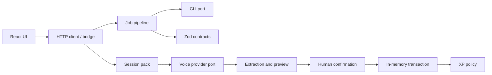
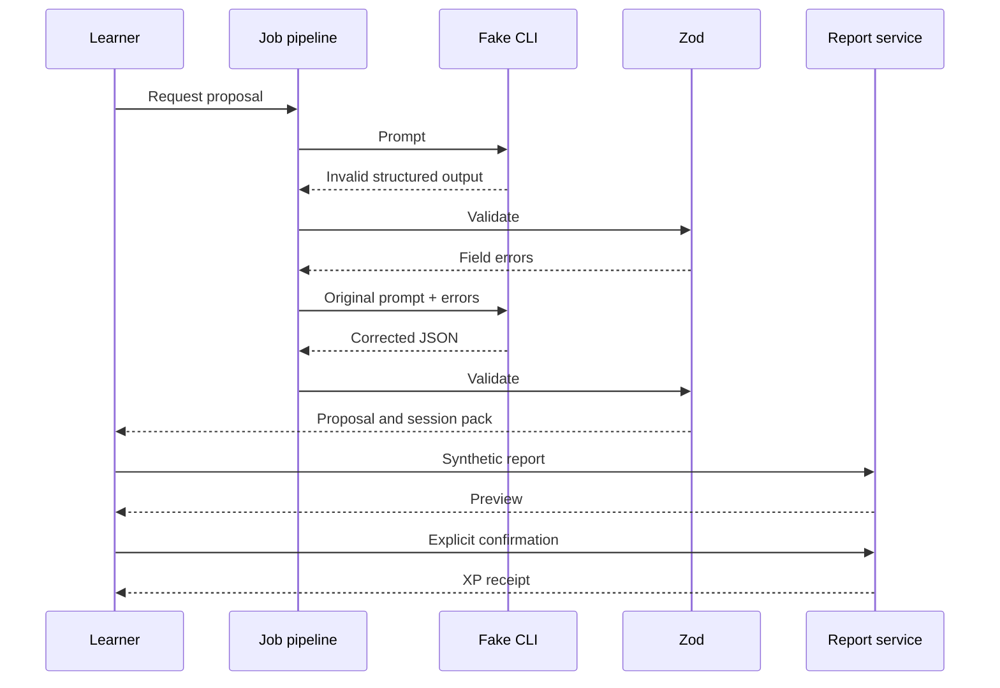
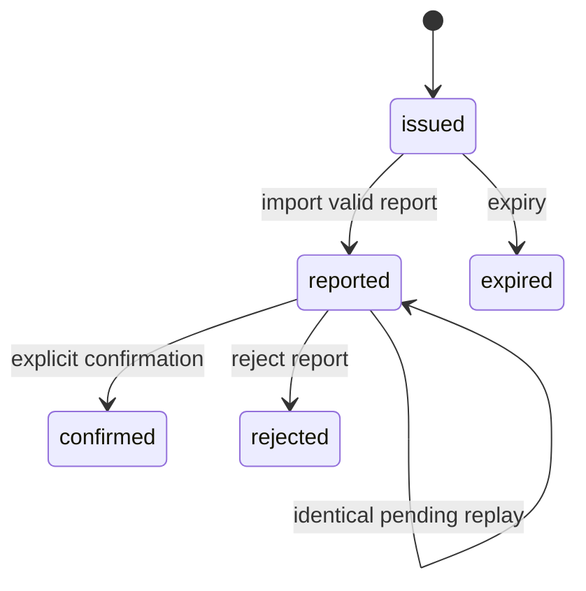

# Architecture

The offline demo assembles these components in one process. The UI, bridge and voice HTTP service are separate examples and are not started by the demo. The original application used locally authenticated CLI tools; the demonstration invokes a synthetic provider.

The diagram summarizes the demonstrated report path. `rejected` is a report state; expiry is checked against the pack at operation time. Other pack states exist in the implementation.

## Errors and retries

The pipeline validates JSON and schema output, includes field errors in a bounded retry, and records failure or quota waiting. The process adapter bounds input and output and terminates timed-out subprocesses. Report extraction requires one ordered delimiter pair and validates the versioned schema. Import rejects ownership, state and evidence conflicts. A replay of identical pending evidence is idempotent; a confirmed report is not importable again.

## Data recording

The demo stores synthetic jobs, pack, report and XP in process memory and writes a small synthetic result to `demo/out/`. The in-memory report store serializes transactions and commits a copy on success. It is not durable or distributed, and does not establish a production privacy, retention, authorization or database transaction policy. See [extraction map](docs/extraction-map.md) for the boundaries of each adapter.
