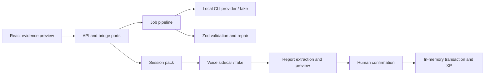

# CALLIOPE — English speaking coach showcase

A local-first prototype for guided English speaking practice, structured evidence and human-approved progression.

This repository presents selected technical slices of a larger private TypeScript monorepo. It combines framework-independent services, React components, shared Zod contracts, a synthetic Python voice sidecar and an offline demonstration.

## Run the offline demo

Requires Node.js 20 and npm.

```sh
npm ci
npm test
npm run demo
```

The demonstration uses synthetic data and fake CLI, speech-to-text and text-to-speech providers. It writes `demo/out/result.json`; no key, model download, database or network service is needed. Some restricted environments prohibit the local IPC socket created by the `tsx` command. In that case, run the same entry point with `node --import tsx demo/run.ts`.

The demo exercises a proposal with a deliberately invalid first response, Zod validation, repair using the validation message, a session pack, synthetic speech, report extraction and scoring, preview, pending-report replay and two concurrent confirmation attempts. The replay is performed while the report is pending; after confirmation, another import is rejected rather than returned as an idempotent success. The in-memory transaction allows one confirmation and one XP award within this process.

## Why this is relevant to Web & AI Prototyping

- **Web and API design:** [confirmation UI](src/web/ReportConfirmation.tsx#L51), [HTTP client](src/web/api-client.ts), and [structured HTTP errors](src/http/problem-details.ts) illustrate an interface and API boundary. They are representative components, not a complete running web application.
- **Structured multi-step LLM work:** [job pipeline](src/llm/job-pipeline.ts#L55) uses caller-supplied Zod schemas, reports validation errors and asks for a corrected response. Its in-memory request key guards repeated submissions in a single process.
- **Provider handling:** [process provider](src/llm/local-cli-worker.ts#L59) bounds input, output and execution time; [worker](src/llm/local-cli-worker.ts#L117) tries configured providers under a time budget. The original system calls locally authenticated CLI tools; it does not require a paid LLM API key.
- **Speech and media:** [voice service](services/voice/main.py#L82) defines injectable transcription and synthesis providers; this showcase supplies fakes, not speech models or streaming inference.
- **Evidence and ownership:** [report import](src/report/report-import.ts#L101) checks learner ownership and report state against a process-local store. [MCP bridge](src/mcp/bridge.ts) defines a service boundary; production authentication and authorization require additional work.
- **Human approval:** [report confirmation](src/web/ReportConfirmation.tsx#L51) and [import service](src/report/report-import.ts#L101) represent preview and explicit confirmation before awarding XP.
- **Operations:** [doctor](deploy/doctor.sh#L1) checks a bounded local service, while [process ownership and health](deploy/common.sh#L29) support the included scripts. These do not deploy the complete original system.
- **Testing and CI:** [demo test](tests/demo.test.ts#L1), [report tests](tests/report/report.test.ts#L1) and [CI workflow](.github/workflows/ci.yml) exercise synthetic cases without private data.

## Architecture



See [architecture](ARCHITECTURE.md) for data flow, states and error boundaries; [highlights](docs/highlights.md) for a short reading path; and [extraction map](docs/extraction-map.md) for source provenance and limits.

## How I used AI coding tools

I used Claude Code and Codex to assist with implementation and review. I was responsible for architecture, requirements decomposition, review and acceptance. The showcase is a selected adaptation and does not imply that an AI tool independently validated the original system or production behavior.

## Limitations & trade-offs

- NestJS decorators, generated Prisma clients and BullMQ are represented by plain classes and injected interfaces. The included stores and queues are in-memory, reset on exit and do not prove real database transactions, distributed concurrency or persistent exactly-once delivery.
- The demo uses deterministic fake CLI and speech providers. It does not demonstrate an actual speech model, live audio streaming, a real participant, networked infrastructure or production authentication.
- The web components and service ports are extracts, not a deployable full-stack product. Some contracts and projections are intentionally simplified; consult the extraction map before assuming parity.
- Report replay is idempotent only while the same report remains pending. Once confirmed, a repeat import conflicts. Concurrent confirmation is serialized in one process; a persistent implementation needs transaction and uniqueness guarantees of its own.
- The optional voice HTTP sidecar uses standard-library synthetic providers. The document converter can optionally use an independently installed local Docling environment; neither proves production model quality.
- Source scale, measured from tracked files using `git ls-files` and line counts for eligible `.ts`, `.tsx`, `.py` and `.sh` files after excluding the specified sensitive directories: **250 files, 53,295 lines**. Among these, **69** filenames contain `.spec.` or `.test.`, with **425** literal `it(` / `test(` occurrences. These are approximate textual counts, not executed tests or total project size.
- Tests use synthetic fixtures and offline substitutes. Passing tests cannot establish usability, privacy compliance, clinical effectiveness or deployment readiness.

## Further reading

- [Installation](docs/install.md) and [usage](docs/usage-guide.md)
- [Redaction log](docs/redaction-log.md)
- [Synthetic demo output](docs/screenshots/README.md)
- [Selection rationale](PLAN.md)

## 繁體中文摘要

這個展示版呈現本機優先英語口說教練的部分技術設計，包括結構化輸出驗證與修正、語音介面抽象、學習紀錄預覽、人工確認與經驗值計算。示範採用合成資料及記憶體元件；它不代表真實語音模型、正式資料庫交易或完整產品部署已通過驗證。
